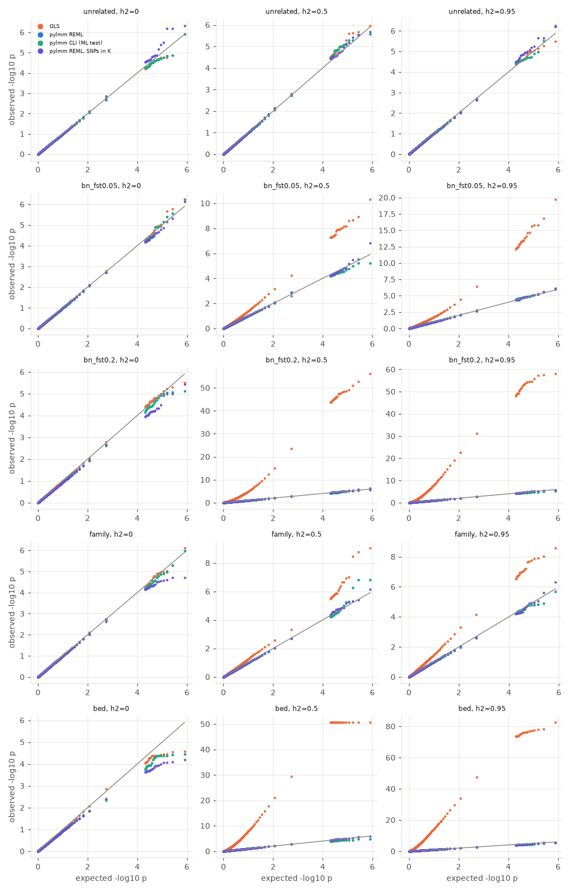
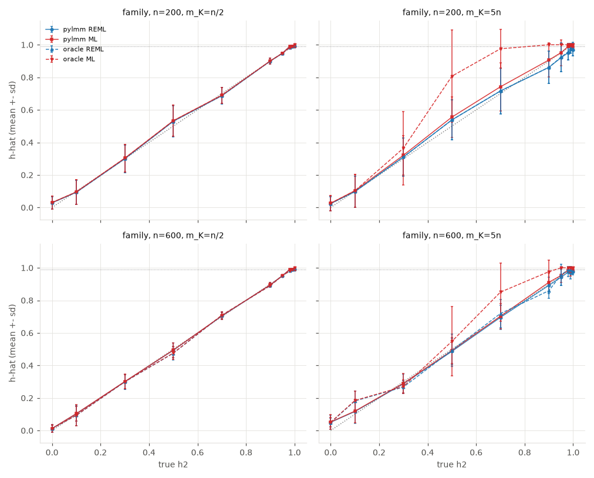
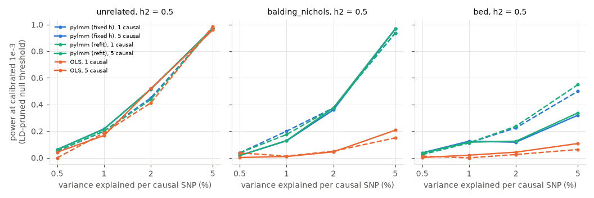

# Phase 4: simulation study synthesis

This report pulls together the five Phase 4 studies (S1–S5) on the Python 3
port of pylmm: what is statistically sound, what fails, and which fixes were
scheduled first (Phase 5) and which later (Phase 6.3); §6 says which of them
1.0.0 contains. Each number
below comes from a committed study summary (`sims/results/<study>/summary.*`,
`sims/studies/<study>.md`) or from `sims/synthesis.py`, whose outputs are in
[`sims/results/synthesis/`](../sims/results/synthesis/). To reproduce them:
`uv run --group sims python sims/synthesis.py` (about 8 min; it needs the
gitignored `raw/full.jsonl` files, and reads only the rows of each study's
current grid and `STUDY_VERSION`). "Confirmed" means a reproducer or a
measured effect with a CI that excludes zero. "Suggestive" means a small
sample or a CI that is optimistic.

## 1. TL;DR

* **On its default path, and under a correctly specified model, pylmm is
  statistically correct.** Every study simulates the polygenic effect from the
  same K that is fitted (§7), so these are calibration results for an exactly
  specified model. With the REML null fit and the Wald test, null p-values
  are calibrated on all five genotype structures when h² > 0. Pooled type-I
  error at α = 0.05 is 0.0495–0.0500, at α = 1e-3 it is (0.93–1.02)×10⁻³,
  and the mean χ² is 0.99–1.01 (1,575 replicates, replicate-cluster CIs).
  The Wald t matches an independent dense oracle to 2e-7, and the oracle's
  Wald test matches a direct GLS with K ≠ I to 1e-9 (tests). For h² ≤ 0.95,
  pylmm's REML ĥ is within an RMS of 0.0033 of the textbook optimum.
* **pylmm is a real improvement on OLS.** Under structure, OLS is badly
  inflated: pooled type-I error at 0.05 reaches 0.55 on the mouse BED data,
  with a mean χ² of 14. Part of that is built into the design: the
  phenotype's polygenic component is drawn from the very K that pylmm
  fits, so OLS faces exactly the structure the LMM models. At a calibrated
  1e-3 threshold the two have about the same power on unrelated data: the
  CIs overlap, though pylmm is ahead at h² = 0.8 (0.60 vs 0.43 at 2%).
  Across all 72 main S3 cells OLS is ahead in only 3, by ≤ 0.013. With
  structure, pylmm has much more power. For example, at h² = 0.5 with one SNP explaining 5% of
  variance: Balding–Nichols 0.94 vs 0.15, BED 0.50 vs 0.06. At h² = 0.8,
  OLS's calibrated power is about 0.
* **The main failure is a crash (bug 4), and it is new with the Python 3
  port's scipy.** When the REML optimum lies at about 0.96–0.975, the
  unbounded Brent bracket search steps above h = 1, where pylmm's LL is nan.
  On scipy ≥ 1.11 that raises `BracketError`, which aborts the fit, and with
  it the whole GWAS or CLI run. This happened in 107 of 13,024 full-run
  replicates (0.8%), all but one at true h² ≥ 0.7:
  * pooled S1 rates of 2.3% at h² = 0.8 and 4.0% at h² = 0.95;
  * 11.5% at h² = 0.98 with n = 200 (S2);
  * up to 8.8% in one 80-replicate cell (S1 family, h² = 0.95), and 12.5% in
    S4 (BED, n = 300, h² = 0.95).

  Per-SNP refits crash on 0.25–2.8% of SNPs at h² 0.8–0.99 (S4), so a
  `--refit` scan of a high-h² trait will almost surely abort. On scipy < 1.11
  the same code does not crash: replayed on scipy 1.9, 90 of the 95 crashed
  null fits return the correct bounded optimum (to 7e-8), and the other 5 (ML
  with an unbounded profile, bug 17) return h slightly above 1 (§4). The fix
  is the same either way: a bounded search.
* **ĥ near 1 is wrong by construction (bugs 2 and 3).** The grid stops at 0.99,
  and index 98 (h = 0.98) is never tested. At true h² = 0.98, 99% of
  well-identified REML fits return 0.99; at h² = 1 every well-identified fit
  returns 0.99.
  The error in ĥ is at most about 0.01. The p-value effect is usually ≤ 0.04
  in −log10 p, but reaches 0.81 on BED at h² = 0.99 (S4).
* **The CLI's documented "ML default" is really a REML Wald test (bug 1).**
  `GWAS(REML=False)` and `REML=True` give identical p-values in all 25 S1
  cells. Numerically this is harmless (|Δt| ≤ 0.04 against a textbook ML
  Wald). However, `--removeMissingGenotypes` and `--refit` silently switch to
  ML and then disagree with the library. With `--removeMissingGenotypes` the
  relative t error is 2–10% (S5).
* **ML fails with a centred GRM built from more SNPs than individuals (bug 17).**
  This is a property of the model, not a code bug. There is then no MLE, and
  pylmm's ML ĥ is an artifact of the clamp and the cap: up to +0.16 against
  REML (S4's worst cell, n = 200, m = 2000, h² = 0.5), ≈ +0.03 on average in S2 (m > n, h² ≤ 0.95), and
  33–52% of ML fits sit at 0.99. REML is unaffected.
* **Input validation is the other weak area.** pylmm silently accepts a
  wrong-size `--kfile` (bug 16), a mis-ordered or non-PSD K, saturated designs
  and constant phenotypes, and returns plausible-looking numbers (S5: 22
  critical- or high-severity "wrong" outcomes and 19 crashes in 161 cases).
  New issues 19–25 are in the ledger.
* **Excluding crashed replicates does not change the calibration or power
  conclusions.** When the crashed replicates are refitted with a bounded
  search, pooled type-I error moves by ≤ 0.0008, fixed-h power by ≤ 0.006
  and per-SNP-refit power by ≤ 0.007. It does bias a few S2 high-h² ĥ
  summaries, by up to 0.03, because a crash selects replicates with
  ĥ ≈ 0.96 (§4).

## 2. Setup

**Framework.** `sims/` ([README](../sims/README.md)) runs a study as a grid of
cells × replicates, and every task has a deterministic seed. Each replicate
simulates y = Xβ + Σ βⱼgⱼ + u + e with u ~ N(0, h²σ²K), where K is pylmm's
own `calculateKinship`, and the same K is then used for the fit, so the
model is exactly specified (§7). The replicate is fitted with pylmm
(unchanged) and with comparators: OLS, and the oracle. Nothing in `pylmm/`
was modified.

**Independent oracle** ([`sims/oracle.py`](../sims/oracle.py)). The oracle is
a dense Cholesky profile (RE)ML fit over a 201-point grid on [0, 1] plus
bounded Brent, and it shares no code with pylmm. It is validated in
`tests/sims/test_sims_oracle.py` against:

* K = I (OLS);
* closed-form balanced-ANOVA REML and ML;
* the error-contrast and multivariate-normal log-densities;
* a 2001-point grid;
* statsmodels `MixedLM`, to 1e-5 in h;
* for the Wald test with K ≠ I at fixed h: a direct GLS by eigen-whitening and
  least squares, and statsmodels `GLS` (β̂, se, t and p to 1e-8).

The oracle has switches for each pylmm convention (`h_grid="pylmm"`,
`eig_clamp=1e-6`, the REML/ML split, the σ convention). With all of them set
to pylmm's behaviour it reproduces pylmm: |Δh| ≤ 3e-8 and |Δt| ≤ 1e-8 on a BED
subset, and max |Δĥ| = 1.2e-7 over every S2 oracle replicate (synthesis). Each
switch can be flipped on its own, which is how the S2/S4 attributions
separate estimator, optimizer and clamp effects.

**Genotype structures.**

| structure | used in | what it is |
|---|---|---|
| `unrelated` | S1–S5 | independent HWE SNPs; K ≈ I (K is exactly the simulation covariance) |
| `balding_nichols` | S1 (F_st 0.05, 0.2), S2/S3 (0.1) | 3 populations |
| `family` | S1, S2 (sibships of 4), S5 (of 5) | nuclear sibships; K is the sampled GRM |
| `bed` | S1–S4 | random subsets of the bundled 1,219 mice. 300 or 600 mice are 97 or 108 distinct genotypes, K has rank ≈ 96–109, and the 5,000 test SNPs act like ≈ 18 independent tests (S4 item 18) |
| `hmdp` | S4 (bug 8) | the 94-strain text data |

**Compute actually used.** The benchmarks ran on an Apple M1, 8 cores,
16 GB, with numpy 2.5.4, scipy 1.18.1 and Python 3.13.9. S1–S3 used
`--jobs 4`; the runner's default cap on that machine is 6. Wall time and task time below are from each
`summary.md` header.

| study | tasks (cells × reps) | wall | total task CPU |
|---|---|---|---|
| S1 null calibration | 2,000 (25 × 80) | 46.6 min | 3.09 h |
| S2 h² recovery | 3,984 (320 × 12 + 12 probe × 12) | 36.2 min | 2.41 h |
| S3 power | 7,040 (88 × 80) | 33.9 min | 2.26 h |
| S4 bug confirmation | final invocation 338 s at `--jobs 2` | 5.6 min | 0.32 h (all runs) |
| S5 edge cases | 966 (161 × 6) | 5.4 min | 0.18 h |

The total is about 2.1 h of wall time and 8.3 core-hours.
`synthesis.py` adds about 8 min. It replays crashed, S2 and S3 replicates
from their stored seeds. The replay is verified: it reproduces the stored S3
p-values on 80 replicates and the stored S2 profile flags on all 7,832 S2
fits, and every replayed crash still crashes.

## 3. Results

### 3.1 Null calibration (S1)

S1 used n = 600 and 80 replicates per cell, with 5,000 null SNPs per
replicate, disjoint from the 6,000 SNPs used for K. Following S4's rule, the
table uses **pooled type-I error with replicate-cluster CIs and the mean χ²**,
not single-replicate λ_GC. On BED, single-replicate λ is noise-dominated: its
5–95% range is 0.69–1.46 for pylmm even when pylmm is calibrated.

Pooled over h² ∈ {0.2, 0.5, 0.8, 0.95}, about 315 replicates per row
([`s1_calibration_pooled.csv`](../sims/results/synthesis/s1_calibration_pooled.csv)):

| structure | pylmm t1e @0.05 [95% CI] | pylmm t1e @1e-3 (×10⁻³) | pylmm mean χ² [CI] | OLS t1e @0.05 | OLS mean χ² |
|---|---|---|---|---|---|
| unrelated | 0.0500 [0.0497, 0.0504] | 0.96 [0.91, 1.01] | 1.003 [0.992, 1.014] | 0.050 | 1.00 |
| BN F_st 0.05 | 0.0498 [0.0494, 0.0502] | 0.96 [0.91, 1.01] | 1.003 [0.991, 1.014] | 0.128 | 1.71 |
| BN F_st 0.2 | 0.0495 [0.0491, 0.0499] | 1.02 [0.97, 1.08] | 1.000 [0.989, 1.011] | 0.418 | 7.87 |
| family | 0.0496 [0.0492, 0.0499] | 0.96 [0.91, 1.01] | 0.991 [0.979, 1.003] | 0.104 | 1.44 |
| BED (mice) | 0.0496 [0.0468, 0.0523] | 0.93 [0.66, 1.20] | 1.007 [0.981, 1.032] | 0.554 | 14.2 |

* **Calibrated (confirmed).** The pylmm mean χ² CI includes 1 in every
  structure. Type-I error is within 1% of nominal at 0.05, and within its CI
  at 1e-3. At 1e-4 every structure's CI includes nominal except
  BN F_st 0.05, at 0.74 [0.61, 0.88]×10⁻⁴, which is slightly conservative.
* **h² = 0 is mildly conservative.** BED t1e is 0.037, mean χ² 0.88
  [0.82, 0.93]; BN F_st 0.2 is 0.042. REML puts ĥ at the 0 boundary in about
  70% of replicates and down-weights the rest (S4 item 18). This is a known property of
  plug-in REML and matches S4's exact-test comparison. It is not a bug.
* **The CLI path equals the REML path** in all 25 cells, column for column in
  `s1_null_calibration/summary.md`. This is bug 1, seen at scale.
* **Testing SNPs that are in K does not deflate p-values here** when h² > 0.
  For example, BED `reml_in` has mean χ² 1.000 [0.988, 1.011]. K is built from
  6,000 SNPs, so one SNP contributes little. The S1 design doc's hypothesis 3
  is therefore not supported at this K size. At h² = 0, `reml_in` is
  conservative, like `reml`.
* OLS is calibrated only for unrelated data or h² = 0, as expected.

### 3.2 h² recovery and attribution (S2)

S2 has 4 sources × n ∈ {200, 600} × K from n/2 or 5n SNPs × 10 values of h²,
with 24 replicates per (source, n, m_K, h²). The bias in pylmm's ĥ is split
into three parts using the oracle:

* *estimator*: textbook oracle − truth;
* *optimizer*: oracle with pylmm's search − textbook;
* *clamp*: oracle with the 1e-6 eigenvalue floor − textbook.

Source: [`s2_attribution_compact.csv`](../sims/results/synthesis/s2_attribution_compact.csv),
on oracle replicates (all at n = 200, about 1/3 at n = 600). The bias is the
mean over those same replicates (`bias_pylmm_oracle_reps`), so it is the sum
of the three parts and the interaction; the mean over all replicates
(`bias_pylmm`) differs by ≤ 0.011. "Fits at 0.99" uses all replicates. The
full per-cell tables are in
[`s2_h2_recovery/summary.md`](../sims/results/s2_h2_recovery/summary.md).

| K type | true h² | method | mean bias pylmm | estimator | optimizer | clamp | fits at 0.99 |
|---|---|---|---|---|---|---|---|
| synthetic, m < n | ≤ 0.95 | REML | +0.004 | +0.004 | 0.000 | 0 | 0% |
| synthetic, m < n | 0.98 | REML | +0.010 | +0.001 | **+0.009** | 0 | **99%** |
| synthetic, m < n | 1.0 | REML | −0.010 | 0.000 | **−0.010** | 0 | 100% |
| BED | ≤ 0.95 | REML | −0.006 | −0.006 | 0.000 | 0 | 0% |
| BED | 0.98 | REML | +0.010 | +0.001 | **+0.009** | 0 | **99%** |
| synthetic, m > n | ≤ 0.95 | REML | +0.006 | +0.007 | −0.001 | 0 | 10% |
| synthetic, m > n | 0.98–1.0 | REML | −0.050 to −0.055 | −0.046 to −0.050 | −0.004 to −0.005 | 0 | 53–62% |
| synthetic, m > n | ≤ 0.95 | **ML** | +0.038 | +0.20 (no MLE) | **−0.16** | **−0.06** (interaction +0.06) | 22% |

* **Interior h² (≤ 0.95): pylmm's REML is the textbook estimator (confirmed).**
  The optimizer's mean contribution is ≤ 0.001 and its RMS is ≤ 0.0033. The
  clamp contributes 0. The remaining bias and RMSE (0.05–0.14) are REML's own,
  and they are largest where K is close to I (m > n), where h² is weakly
  identified.
* **h² ≥ 0.98: the optimizer accounts for all of pylmm's error (confirmed).**
  At true h² = 0.98, a well-identified K gives a REML optimum at about 0.98.
  `getMax` never tests index 98 (bug 2), finds no interior peak and returns
  the 0.99 endpoint. At h² = 1 the cap (bug 3) returns 0.99. The ĥ errors are
  ±0.01. With m > n, REML's own sampling noise (estimator bias −0.05)
  dominates the cap.
* **The first-optimum rule never lost a mode under REML.** On either grid, there were 0
  "lost-mode" fits among the 3,916 completed S2 replicates, including the
  misspecified-phenotype probe.
* **ML with m > n is unidentified (bug 17).** The textbook MLE runs to h = 1
  in 100% of these replicates (`ml_cap.csv`). pylmm's ML answer is then set
  by its grid (−0.16) and clamp (−0.06). Its mean happens to land near the
  truth (+0.031 over all 992 fits, +0.027 above REML), but the RMSE is 0.13
  and 22% of fits sit at 0.99, against 10% for REML. On pylmm's own range
  [0, 0.99], its first-optimum rule returns a lower ML mode in 16 of 992 fits
  (`s2_lostmode.csv`): it stops at an interior maximum at ĥ = 0.74–0.91 while
  the LL is higher, by 0.03–0.38, at the 0.99 endpoint, where the unbounded
  ML profile keeps rising. The study's own flag counted 225, but its 201-point
  grid includes h = 0.995 and 1, which pylmm can never return, so a rising
  boundary counted as a lost mode.
* σ² and β are reported as expected. The ML σ is Q/(n−q), which is bug 9, a
  convention: the error is n/(n−1), i.e. 0.5% at n = 200 (`sigma_beta.csv`).
  The intercept β is unbiased.

### 3.3 Power, and LMM vs OLS (S3)

S3 has 3 sources (n = 500/500/600) × h² ∈ {0.2, 0.5, 0.8} × {1, 5} causal SNPs
× variance explained per SNP ∈ {0.5, 1, 2, 5}%, with 80 replicates and 2,000
disjoint test SNPs per replicate.

**Raw power is not comparable here.** OLS's raw type-I error at 1e-5 is
0.06–0.33 on BED (`s3_power/summary.md`). So power is compared at a
*calibrated* threshold: the 1e-3 quantile of each method's own pooled null
p-values in that cell.

**LD caveat (S4 rule).** On BED, the "non-causal" SNPs are not null, because
they tag the causal SNPs through strain LD. Calibrating on them makes the
threshold far too strict. For example, BED pylmm with 5 causal SNPs at 5%
has calibrated power 0.07 when the threshold is set on all non-causal SNPs.
`synthesis.py` therefore recomputes the threshold using only the non-causal
SNPs with r² < 0.1 to every causal SNP of the replicate. On BED that keeps
81–85% of nulls for 1 causal SNP and 46–50% for 5; on synthetic data it keeps
98–100%. Pruning lifts that BED cell from 0.07 to 0.32. For 1 causal SNP, it
brings pylmm's null rate at 1e-3 down to 0.000–0.004. For 5 causal SNPs at
≥ 2%, the pruned BED nulls still reject at 0.003–0.03 (residual tagging), so
those calibrated powers are lower bounds.

Calibrated power at 1e-3 with the LD-pruned threshold, 1 causal SNP, with
Wilson 95% CIs over 80 causal SNPs
([`s3_calibrated_power.csv`](../sims/results/synthesis/s3_calibrated_power.csv)):

| source | h² | SNP explains 2%: pylmm / OLS | SNP explains 5%: pylmm / OLS |
|---|---|---|---|
| unrelated | 0.5 | 0.45 [0.35, 0.56] / 0.41 [0.31, 0.52] | 0.98 / 0.99 |
| unrelated | 0.8 | 0.60 [0.49, 0.70] / 0.43 [0.33, 0.54] | 0.99 / 0.95 |
| Balding–Nichols | 0.5 | 0.38 [0.28, 0.49] / 0.05 [0.02, 0.12] | 0.94 [0.86, 0.97] / 0.15 [0.09, 0.24] |
| Balding–Nichols | 0.8 | 0.65 [0.54, 0.75] / 0.00 [0, 0.05] | 0.99 / 0.15 |
| BED | 0.2 | 0.34 [0.24, 0.45] / 0.04 | 0.75 [0.65, 0.83] / 0.16 |
| BED | 0.5 | 0.23 [0.15, 0.33] / 0.03 | 0.50 [0.39, 0.61] / 0.06 [0.03, 0.14] |
| BED | 0.8 | 0.24 [0.16, 0.34] / 0.00 | 0.70 [0.59, 0.79] / 0.00 [0, 0.05] |

* **pylmm ≥ OLS almost everywhere, and much better under structure
  (confirmed).** On unrelated data the CIs overlap. Even there, at h² = 0.8
  pylmm gains from removing polygenic noise: 0.60 vs 0.43 at 2% (suggestive,
  the CIs overlap). OLS is ahead in 3 of the 72 main cells, all trivially:
  0.988 vs 0.975 (unrelated, h² = 0.5, 5%), 0.520 vs 0.515 (unrelated, 5
  causal at 2%), and 0.012 vs 0 (BED, h² = 0.2, 0.5%).
* **Refit and fixed-h give the same power.** The two power curves coincide
  within their CIs. The paired mean Δlog10 p (refit − fixed) is −0.002 to
  −0.07 ([`s3_checks.csv`](../sims/results/synthesis/s3_checks.csv)).
  However, refit is where 12 of the 14 S3 crashes happened; adding those
  replicates back moves refit power by ≤ 0.007 (§4).
* **The oracle check passes.** pylmm's t at causal SNPs matches the oracle
  Wald to ≤ 1.8e-7, and ĥ to ≤ 1.3e-7.
* **Proximal contamination costs power.** With K from 500 SNPs, adding the 5
  causal SNPs to K drops calibrated power on Balding–Nichols from 0.18 to 0.03
  at 1% and from 0.51 to 0.21 at 2%. On BED it drops from 0.26 to 0.12 at 2%.
  This is a known LMM property, not a pylmm bug.
* For effect sizes, pylmm's mean relative bias of β̂ is within ±0.08 in 71 of
  72 cells. The outlier is +0.21 (BED, h² = 0.5, 1%), where the relative RMSE
  of 0.71 makes it about 2.7 SE from zero, so it is suggestive at most. The
  winner's curse is the expected one (`s3_power/summary.md`).

### 3.4 Edge cases (S5)

S5 has 161 cases, each run through 4 paths (library, library with
imputation, CLI with imputation, CLI with `--removeMissingGenotypes`) with 6
replicates each, judged against the oracle
([`s5_edge_cases/summary.md`](../sims/results/s5_edge_cases/summary.md)).

| outcome | severity | cases | examples |
|---|---|---|---|
| OK | none or warnings only | 101 + 2 | missing genotypes 0–50%, missing phenotypes up to 20%, K of rank 2, K = I, duplicated individuals, scaled K/y/X0, heavy tails, binary y, monomorphic SNPs (nan) |
| wrong | critical | 11 | wrong-size `--kfile` accepted (bug 16); saturated designs give finite t; constant y gives h = 0.99 with σ ≈ 0; `--removeMissingGenotypes` ML/REML mismatch |
| wrong | high | 11 | mis-ordered, upper-triangle-only or non-PSD K accepted silently (Δĥ up to 0.78); `cli_remove` t off by 2–10% |
| wrong | medium | 14 | non-estimable SNP (constant up to rounding, or SNP = covariate) gets t ≈ 1e-8 instead of nan |
| crash | high (valid input) | 4 | `BracketError` (bug 4); all-missing SNP kills the scan (bug 11) |
| crash | medium (invalid input) | 15 | collinear covariates give a bare `LinAlgError`; nan in K or X0; pheno file missing an individual (bug 10); no pheno file (bug 14) |
| silent | medium | 3 | garbage input accepted without a warning |

The core numerics hold up under realistic missingness and odd scaling. The
failures are at the input boundary: no validation of K, X0 or y; no
estimability check; no check of design size. Those are Phase 5 work.

## 4. Crash accounting (bug 4)

**Every missing replicate in S1–S3 is a scipy `BracketError` from pylmm's
unbounded Brent search.** There are 0 other failures
([`crash_accounting.csv`](../sims/results/synthesis/crash_accounting.csv),
[`crash_by_h2.csv`](../sims/results/synthesis/crash_by_h2.csv)):

| study | crashed / tasks | where | cells hit | by h² (pooled over structures) |
|---|---|---|---|---|
| S1 | 25 / 2,000 (1.25%) | null fit | 9 of 25 | h² = 0.8: 9/400 (2.3% [1.2, 4.2]); h² = 0.95: 16/400 (4.0% [2.5, 6.4]); h² ≤ 0.5: 0/1,200 |
| S2 | 68 / 3,984 (1.7%) | null fit: the REML fit in 62 replicates (60 main + 2 probe), the ML fit in 6 | 46 of 332 | h² = 0.98: 22/192 at n = 200 (11.5% [7.7, 16.7]), 8/192 at n = 600; h² = 0.95: 16/384; all at h² ≥ 0.7 except one at h² = 0.3 |
| S3 | 14 / 7,040 (0.2%) | 12 in the per-SNP refit, 2 in the null fit | 7 of 88 | all at h² = 0.8 (14/1,920, 0.7%); 0/5,120 at h² ≤ 0.5 |

Cells hit, n = 600 for S1 (each has 80 replicates):

* unrelated: h² 0.8 (3), 0.95 (3)
* BN F_st 0.05: 0.8 (3), 0.95 (2)
* BN F_st 0.2: 0.8 (2), 0.95 (2)
* family: 0.8 (1), **0.95 (7, i.e. 8.8% [4.3, 17.0])**
* BED: 0.95 (2)

S3 cells hit, all h² = 0.8 and n = 500:

* unrelated, 1 causal: 0.5% (2), 1% (5), 2% (1), 5% (1)
* Balding–Nichols: 1 causal at 2% (2); 5 causal at 0.5% (2) and 2% (1)

The full per-cell list for S2 is in `crash_accounting.csv`. Its rate is 1–3 of
12 per cell.

**The summary statistics for these cells exclude the crashed replicates.**
`n_reps` in each summary shows this (e.g. S1 family h² = 0.95 has 73
replicates). Oracle-based S2 columns exclude the same replicates.

**Does the exclusion bias anything?** The crashes are not random.
`synthesis.py` replayed every crashed replicate from its seed, and checks that
pylmm still crashes on the replayed data (it does, in all 107):

* **They select on ĥ.** For all 25 S1 crashes, the textbook REML optimum is in
  0.960–0.975. For 63 of the 68 S2 crashes it is ≥ 0.955; the other 5 crashed
  in the ML fit, where the ML optimum is at 1. This is exactly the "grid
  maximum at 0.96–0.97, so Brent steps past 1" mechanism. As a result, crashes
  concentrate at high true h², and also hit occasional high-ĥ outliers at
  h² = 0.3–0.9.
* **S1 calibration: no material bias.** The replay refits each crashed
  replicate with a bounded-search stand-in: the oracle's ĥ capped at 0.99,
  with pylmm's own association step. Adding those replicates back changes the
  pooled type-I error at 0.05 by ≤ 0.0008 (BED h² = 0.95: 0.0495 → 0.0503)
  and leaves 1e-3 unchanged to 4 decimals
  ([`crash_bias_s1.csv`](../sims/results/synthesis/crash_bias_s1.csv)).
* **S3 power: no material bias, for fixed-h or refit.** For the fixed-h scan
  the replay uses pylmm's null ĥ (or the capped oracle ĥ for the 2 null-fit
  crashes). For the refit it refits every SNP the study refits (the causal
  SNPs and the 100-SNP null sample) with pylmm, and uses the capped oracle ĥ
  of [1, x] for each SNP whose refit crashes. Adding the replayed replicates
  back changes pylmm's Bonferroni power by ≤ 0.006 with fixed h and by
  ≤ 0.007 with refit
  ([`crash_bias_s3.csv`](../sims/results/synthesis/crash_bias_s3.csv)). In
  those 14 replicates, 1–27% of the 101–105 refitted SNPs crash (1–4% in 9 of
  them), and 32% and 63% in the two whose null fit also crashed.
* **S2 h² summaries: a small, real bias in some cells.** Excluding high-ĥ
  replicates pulls the reported mean ĥ down, except at true h² ≥ 0.98, where
  pylmm's 0.99 is above the crashed replicates' optimum. Including them, with
  ĥ set to min(oracle, 0.99) where pylmm's REML fit crashed, changes the bias
  as follows:
  * by +0.03 in unrelated n = 200 m > n h² = 0.3 (−0.054 → −0.024);
  * by +0.01 in family n = 200 m > n h² = 0.7 and in unrelated n = 600
    m > n h² = 0.7;
  * by ≤ 0.008 in the other 31 cells; in the m < n h² = 0.98 cells the bias
    moves from +0.010 to +0.005–0.009
  ([`crash_bias_s2.csv`](../sims/results/synthesis/crash_bias_s2.csv)). The
  attribution conclusions do not change. The h² ≥ 0.95 rows of
  `s2_h2_recovery/summary.md` should be read as "conditional on pylmm not
  crashing".

**Bug 4 on older scipy (replayed).** The crash needs scipy ≥ 1.11, where
scipy's bracket search raises `BracketError` on the nan it gets above h = 1.
`pylmm` declares `scipy>=1.9`, and its lowest-direct CI job runs scipy 1.9.
We replayed the 95 crashed *null* fits of S1–S3 (25 S1, 68 S2, 2 S3) with the
same pylmm code on Python 3.10, numpy 1.22.0 and scipy 1.9.0:

* none crashes;
* 90 (all 89 REML fits and the one ML fit with a bounded profile) return the
  correct optimum: |ĥ − oracle ĥ| ≤ 7e-8 against the textbook oracle with
  pylmm's 1e-6 eigenvalue clamp (ĥ = 0.960–0.975, so the 0.99 cap does not
  bind). Brent's bracket search wanders above 1, gets nan, and still
  converges to the interior optimum;
* the other 5 are ML fits of an S2 m > n cell, where the ML profile is
  unbounded (bug 17). There scipy 1.9 returns ĥ = 1.002–1.035, outside
  [0, 1]: pylmm's LL at that ĥ is nan, while σ² and the association t
  stay finite, so the output looks plausible;
* pylmm's nan → H[i−1] fallback (lmm.py `getMax`) never fired, on either scipy.

So the crash is a behaviour change of the Python 3 port on a current scipy,
not a property of the original code: on the old stack the same search gave
correct REML fits. The bounded-search fix (§6) is unchanged; it also removes
the ĥ > 1 answers on old scipy. The 12 per-SNP refit crashes in S3 were not
replayed on old scipy; they are the same REML search with one more
covariate.

### After the Phase 5.1 fix

Phase 5.1 replaced the unbounded Brent with a bounded search inside the
bracketing grid interval (`minimize_scalar(method="bounded")`, xatol 1e-10),
for the null fit and the per-SNP refit. The 0.99 cap, the `range(1, n−2)`
scan and first-not-best are kept (bugs 2 and 3, Phase 6.3). The oracle's
`h_grid="pylmm"` search mirrors the change. We reran only the missing
replicates of S1–S3 in place (`python -m sims run <study> --jobs 4`), on
scipy 1.18.1 and numpy 2.5.4:

| study | crashed before | crashed after | replicates rerun | wall time (4 jobs) |
|---|---|---|---|---|
| S1 | 25 / 2,000 | **0** / 2,000 | 25 | 33 s |
| S2 | 68 / 3,984 | **0** / 3,984 | 68 | 51 s |
| S3 | 14 / 7,040 | **0** / 7,040 | 14 | 5 s |

Every cell is back to its full count (80 for S1 and S3, 12 for S2), and
`raw/full.errors.jsonl` is empty. The rerun added exactly the 107 formerly
crashed (cell, rep) pairs, with the same seeds.

The new search is strictly "the local optimum within the first grid peak's
bracket". The old unbounded Brent could in principle escape into a
neighbouring mode. That was observed in 8.8% of adversarial synthetic
two-bump profiles, but in 0/2,100 simulated fits and 0/183 real bimodal S2
fits. On non-crashing fits the largest differences are |Δh| = 7e-8 and
|Δt| = 2.8e-7.

**Previously completed replicates are unchanged.** Their rows were not
rerun, and `raw/full.jsonl` is a byte-identical prefix of the new file. As a
check that the new search reproduces them, we recomputed 124 completed
replicates with the fixed code: 2 from each of the 62 cells that had a
crash (18 S1, 92 S2, 14 S3). Every stored metric matched to ≤ 1.4e-7
absolute (ĥ, σ², λ_GC, p-value samples), which is optimizer tolerance. The
Phase 1 goldens moved by ≤ 7.3e-9 on any fitted h and ≤ 2.8e-7 on any
t-statistic, which is at most 7% of the `tests/helpers.py` tolerances.

The study summaries (`sims/results/s1_null_calibration`, `s2_h2_recovery`,
`s3_power`) and the synthesis parts `s1`, `s2lost`, `s2` and `s3` were
regenerated with the added replicates. The changes match the crash-bias
replay above:

* S1 pooled type-I error of the pylmm methods changes by ≤ 0.0002 at 0.05
  (BED REML h² > 0: 0.0496 → 0.0498).
* S2: unrelated n = 200 m > n h² = 0.3 REML bias goes from −0.054 to −0.024.
  Family n = 200 and unrelated n = 600 at m > n h² = 0.7 move by +0.010.
  Every other cell moves by ≤ 0.008.
* S3 Bonferroni power changes by ≤ 0.006 for fixed h and ≤ 0.007 for refit.

The h² ≥ 0.95 rows of the S2 summary no longer exclude any replicates. The
numbers in §3, and earlier in this section, are the pre-fix
(crash-excluded) ones.
`crash_accounting.csv`, `crash_by_h2.csv` and `crash_bias_*.csv` are kept as
the pre-fix record and were not regenerated. Rerunning `synthesis.py crash`
now reports 0 crashed and 0 other missing in all three studies.
`crashbias` has nothing left to replay.

## 5. Consolidated bug ledger

The machine-readable version is
[`bug_ledger.csv`](../sims/results/synthesis/bug_ledger.csv). Items 1–18 are
S4's ledger, with impacts updated from the full runs; 19–25 are new from S5.
Phase 5 means behaviour and robustness; Phase 6.3 means numerics, where the
fix changes results. Its `status` column marks the fixed items (4 and 16:
fixed in Phase 5.1; 1, 6, 7, 10–14 and 19–24 fixed, 9 fixed for the ML
test and 15 partly fixed in Phase 5.2). The measured impacts are the pre-fix
ones.

| # | issue | verdict | severity | measured impact | path | phase |
|---|---|---|---|---|---|---|
| 4 | Brent unbounded above h = 1 (**fixed in Phase 5.1**) | CONFIRMED | **high** | scipy ≥ 1.11: crash in S1 25/2,000, S2 68/3,984, S3 14/7,040; up to 12.5% per cell; per-SNP refit 0.25–2.8% of SNPs. scipy < 1.11: no crash; correct REML ĥ (90/95 replayed fits), ĥ = 1.002–1.035 with nan LL for unbounded ML (5/95) | every null fit and refit | **5** |
| 16 | `--kfile` read unchecked (**fixed in Phase 5.1**) | CONFIRMED | **high** | wrong-size K accepted, exit 0 (6/6); a headered K becomes all zeros on numpy < 2.3 | CLI `--kfile` | **5** |
| 21 | K not validated (order, symmetry, PSD, nan) — new (**fixed in Phase 5.2**; order only via the library's optional `ids`/`K_ids`) | CONFIRMED | high | permuted K: Δĥ up to 0.78, corr(t) < 0.9, no warning | `LMM`; CLI | 5 |
| 20 | saturated design (n ≤ q+1) gives finite t — new (**fixed in Phase 5.2**) | CONFIRMED | high | 8–20 of 20 SNPs, every replicate | `LMM`/`GWAS` | 5 |
| 1 | null fit always REML; `REML=` only reaches the Wald step (**fixed in Phase 5.2**) | CONFIRMED | medium | default path: CLI ≡ REML (25/25 S1 cells), max \|Δt\| 0.039 vs ML Wald; `--removeMissingGenotypes`: t off by 2–10% | CLI default; `GWAS(REML=False)`; `--refit` | 5 (needs a decision) |
| 3 | h grid stops at 0.99 (also `fitTwo`) | CONFIRMED | medium | ĥ = 0.99 for every well-identified fit at h² = 1 (S2); 38–46% of fits at h² 0.95–0.99; max Δ−log10 p 0.81 (BED h² = 0.99) | every null fit; `misc.fitTwo` | 6.3 |
| 10 | `getPhenos` skips individuals (**fixed in Phase 5.2**) | CONFIRMED | medium | CLI crashes; a silent row shift only for library callers | CLI; `input.plink` | 5 |
| 11 | all-missing SNP gives an empty array (**fixed in Phase 5.2**) | CONFIRMED | medium | the whole scan aborts (6/6) | `GWAS`; CLIs | 5 |
| 17 | ML unbounded, centred GRM with m > n | NOT A BUG (property) | medium | pylmm ML ĥ up to +0.16 vs REML (S4), ≈ +0.03 on average (S2, h² ≤ 0.95); 33–52% of ML fits at 0.99 | ML paths only | 6.3 |
| 19 | non-estimable SNP gets t ≈ 0, not nan — new (**fixed in Phase 5.2**) | CONFIRMED | medium | \|t\| ≤ 1e-6, 17–100% of replicates | `GWAS`; CLI | 5 |
| 22 | constant phenotype gives h = 0.99, σ ≈ 0, or a crash — new (**fixed in Phase 5.2**) | CONFIRMED | medium | 50–67% of replicates give finite numbers | `LMM`; CLI | 5 |
| 23 | collinear covariates give a bare `LinAlgError` — new (**fixed in Phase 5.2**) | CONFIRMED | medium | crash, no message about covariates (6/6) | `LMM`; CLI | 5 |
| 2 | `getMax` skips grid index 98 | CONFIRMED | low | 99% of fits return 0.99 at true h² = 0.98 (S2); \|Δh\| ≤ 0.01 | every null fit | 6.3 (with 3) |
| 8 | two kinship normalisations; denominator | CONFIRMED | low | Δĥ +0.017 (hmdp), +0.06 at 25% monomorphic; t and p unchanged under rescaling | `calculateKinship`, `pylmmKinship` | 6.3 |
| 6, 7 | `--kfile2` NameError; `--eigen` cannot read pylmmKinship output (**fixed in Phase 5.2**) | CONFIRMED | low | crash 100% when used | CLI | 5 |
| 12, 14 | in-place mutation; no pheno file gives TypeError (**fixed in Phase 5.2**) | CONFIRMED | low | caller arrays changed; a traceback instead of a usage message | API; CLI | 5 |
| 24 | non-finite inputs not validated — new (**fixed in Phase 5.2**) | CONFIRMED | low | scipy error with no context; inf y gives all nan silently | API | 5 |
| 25 | badly scaled covariates warn — new | CONFIRMED | low | answers correct to 1e-7; `LinAlgWarning` only | `getMLSoln` | 6.3 |
| 9 | ML σ² = Q/(n−q) (**fixed in Phase 5.2** for the ML test; `fit()`'s σ unchanged) | CONVENTION | cosmetic | t ratio √(n/(n−p)) = 1.0034 at n = 300 | `association(REML=False)` | 6.3 (document) |
| 13, 15 | zero-variance filters differ; return types (13 **fixed**, 15 **partly fixed in Phase 5.2**) | CONFIRMED | cosmetic | no numeric effect on BED coding; list vs ndarray | CLI; API | 5 |
| 5 | `tstat(log=True)` adds 2 instead of log 2 | UNREACHABLE | cosmetic | 1.307 in log p; no caller | none | 6.3 |
| 18 | λ_GC 1.3–4.9 on BED | NOT A BUG | none | pooled t1e 0.038–0.055 vs 0.049–0.058 for the exact test | study design | – |

Sources: S4 [`ledger.csv`](../sims/results/s4_bug_confirmation/ledger.csv),
[`summary.md`](../sims/results/s4_bug_confirmation/summary.md) (full-run
`hgrid` table: BED h² = 0.99 has max \|Δ−log10 p\| 0.81, and BED n = 300
h² = 0.95 has a crash rate of 12.5% over 40 replicates), and the S5 and
synthesis files cited above.

## 6. What was fixed, what is still open

The last column of the ledger above records where each bug was scheduled at
the time: "5" for the robustness fixes, "6.3" for result-changing numerics.

* **Fixed in 1.0.0** (each S4 reproducer is now a regression test in
  [`tests/sims/test_s4_reproducers.py`](../tests/sims/test_s4_reproducers.py),
  and the S5 robustness cases are in `tests/test_input_validation.py`,
  `tests/test_kinship_file.py` and `tests/test_h_search.py`): bug 4 (bounded
  h search, no `BracketError` or nan fallback), bug 16 (kinship files are
  checked), bug 1 (REML is the explicit default and `--ml` is a real ML
  path), bugs 6 and 7 (`--kfile2` removed, `--eigen` reads what
  `pylmm kinship` writes), and the input-validation bundle: bugs 10, 11,
  12, 14, 19–24, 13 and part of 15, plus the ML Wald test of bug 9.
* **Still open**, as known issues listed under "Known caveats" in
  [AGENTS.md](../AGENTS.md): bugs 2 and 3 (the h grid stops at 0.99), bug 8
  (the two kinship normalisations; monomorphic SNPs counted in `m`), bug 9
  for `fit()`'s ML σ², bug 5 (`tstat(log=True)`, unreachable) and bug 25
  (a `LinAlgWarning` for badly scaled covariates; answers correct). Bug 17
  is a property of ML with a centred K, documented rather than fixed. Their
  reproducers stay `xfail(strict=True)`: each will XPASS, and so fail the
  suite, when its fix lands, and the marker must then be removed.

## 7. Caveats and limits

* **CIs are optimistic under LD and shared phenotypes.**
  * S1's pooled CIs here are replicate-cluster CIs, which account for SNPs
    that share a phenotype. They do not account for between-design
    variation: each cell uses one genotype draw (`geno_seed` = 1).
  * The Wilson CIs in the original study summaries treat SNPs as
    independent. On BED and family data, read `*` marks at α ≤ 1e-3 as
    suggestive only.
* **BED has about 18 effective tests.**
  * A single-replicate λ_GC is the median of about 18 correlated χ², so it
    is noisy even for an exact test (S4: 5–95% range about 0.5–1.9).
  * For calibration, use the pooled type-I error and mean χ² (§3.1).
  * BED results describe this panel of about 100 inbred-strain genotypes,
    not outbred human data.
* **S3's BED calibrated power is a lower bound for 5 causal SNPs.**
  * LD pruning at r² < 0.1 leaves residual tagging: the pruned null rate at
    1e-3 is up to 0.03.
  * The calibrated threshold rests on about 8 null p-values per cell at
    1e-3, and the Wilson CIs on power ignore that uncertainty.
* **Fixed: S3's summary used to pool two designs in 8 rows.** The rows for
  (BN, BED) × h² = 0.5 × 5 causal × contam = 0 combined the main cell (K from
  1,500 SNPs) with the contamination arm's control (K from 500 SNPs).
  `s3_power.report()` now keys on `m_kin`, and `s3_power/summary.*` and
  `power_table.csv` were regenerated from the raw rows. Only those 8 rows
  changed; `synthesis.py` had always kept the designs apart. More generally,
  every loader now keeps only the rows of the current grid and
  `STUDY_VERSION` (`runner.current_rows`), and groups on every grid key.
* **The model is exactly specified.** Every study draws the polygenic
  effect u ~ N(0, h²σ²K) from the very K that is then fitted, on every
  structure (BED and Balding–Nichols included: K is the GRM of the K SNPs,
  and it is also the simulation covariance). The only deliberate
  misspecifications are S2's small probe and S3's contamination arm (K
  rebuilt with the causal SNPs). The calibration and power results therefore
  hold under the correctly specified model. They also flatter the LMM
  against OLS a little: the structure OLS ignores is exactly the structure
  the LMM is given. **Robustness to K misspecification** (u drawn from the
  true relatedness, or from causal SNPs, while K is estimated from other
  SNPs) **is not tested**; it is a candidate for a later study. Real-data
  calibration can be worse for reasons pylmm cannot control.
* **Sample sizes are modest.**
  * n ≤ 600 everywhere; large-n behaviour is not tested.
  * S4 cells have 20–40 replicates, S2 has 24 per (source, n, m_K, h²), and
    S5 has 6 per case. S5 frequencies are a guide only.
  * The S2 oracle at n = 600 runs on about a third of the replicates.
* **Bug 4 depends on the software version.** The crash needs scipy ≥ 1.11.
  On scipy 1.9 the 95 crashed null fits replayed (§4) give the correct REML
  ĥ, or ĥ slightly above 1 for an unbounded ML profile; the nan → H[i−1]
  fallback never fires. Apart from that replay, all runs used the one
  software stack listed in §2.
* **The raw results are not archived (won't fix here).** The
  `raw/full.jsonl` files (about 100 MB) are gitignored, so the synthesis and
  every recomputation in this report need a checkout that has them.
* **The oracle shares pylmm's model** (V = σ²(hK + (1−h)I), a Wald test with
  t(n−q)). It checks pylmm's arithmetic and optimisation, not the choice of
  model.
